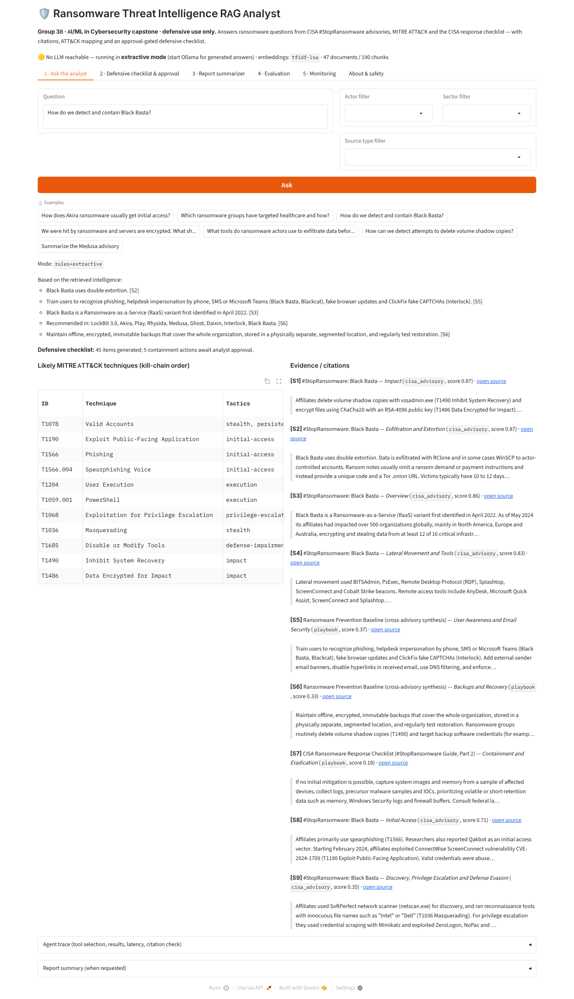
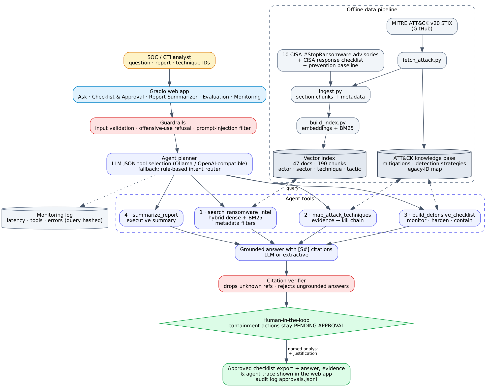
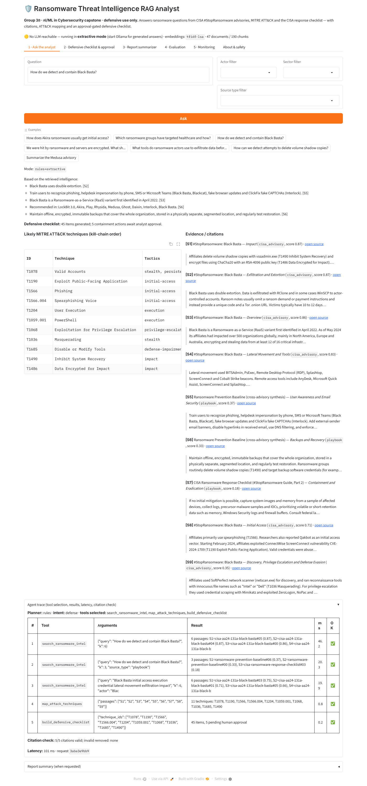
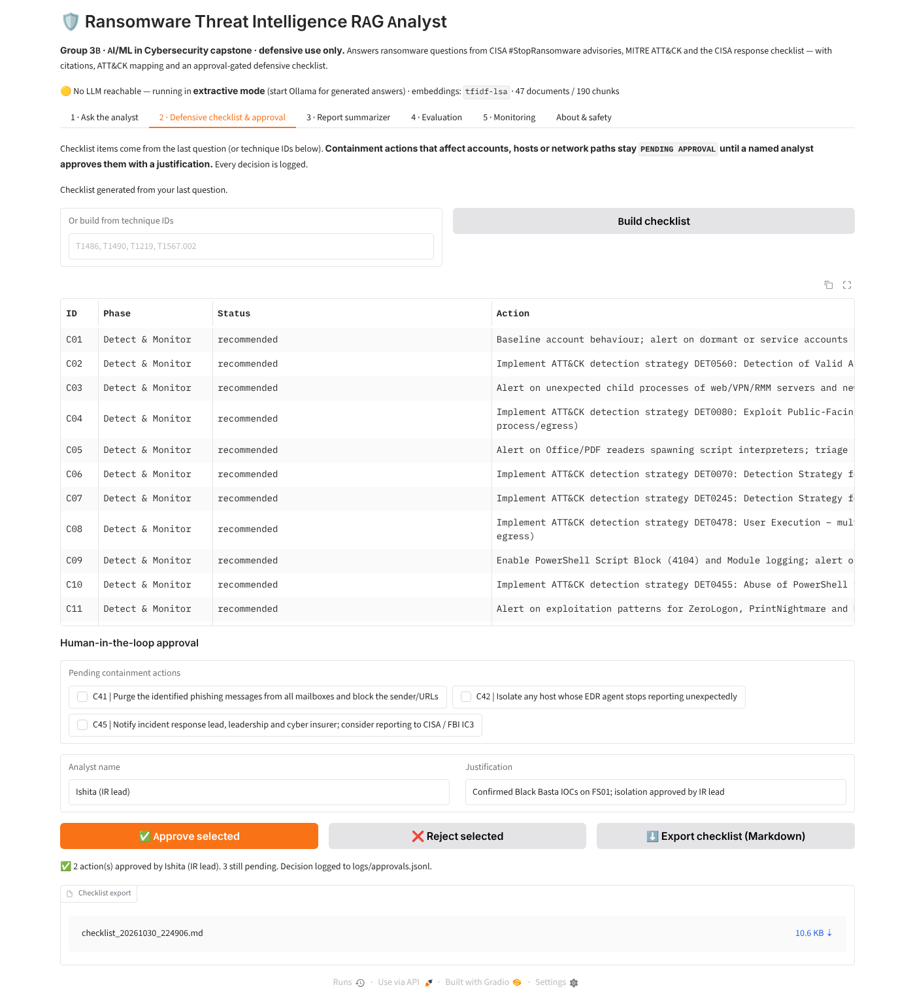
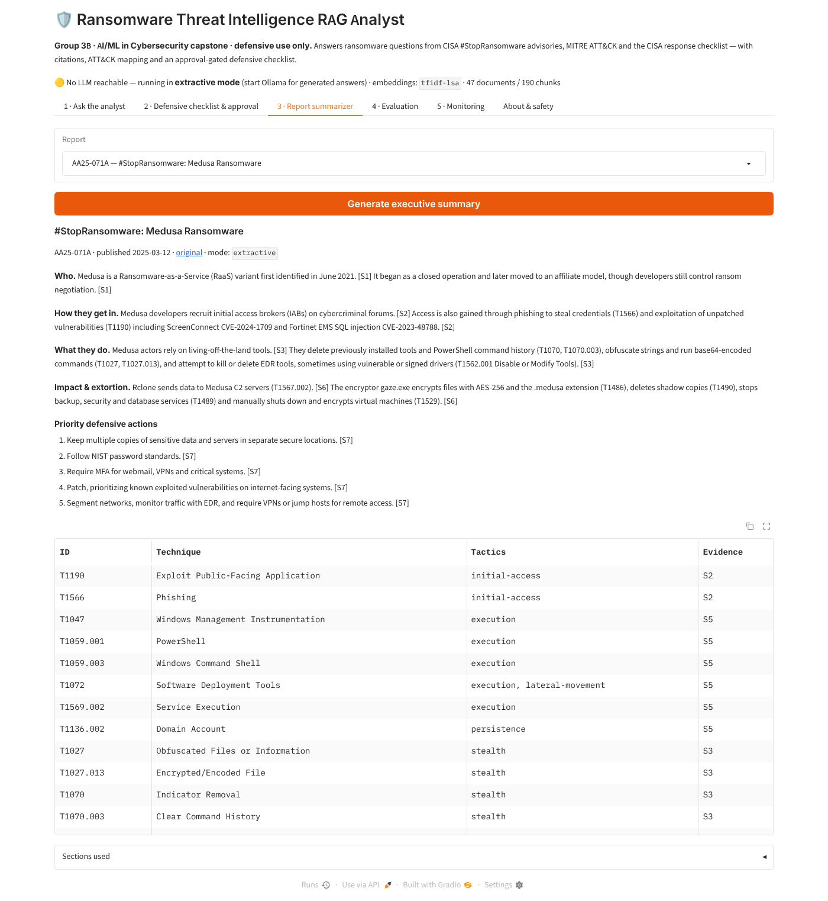
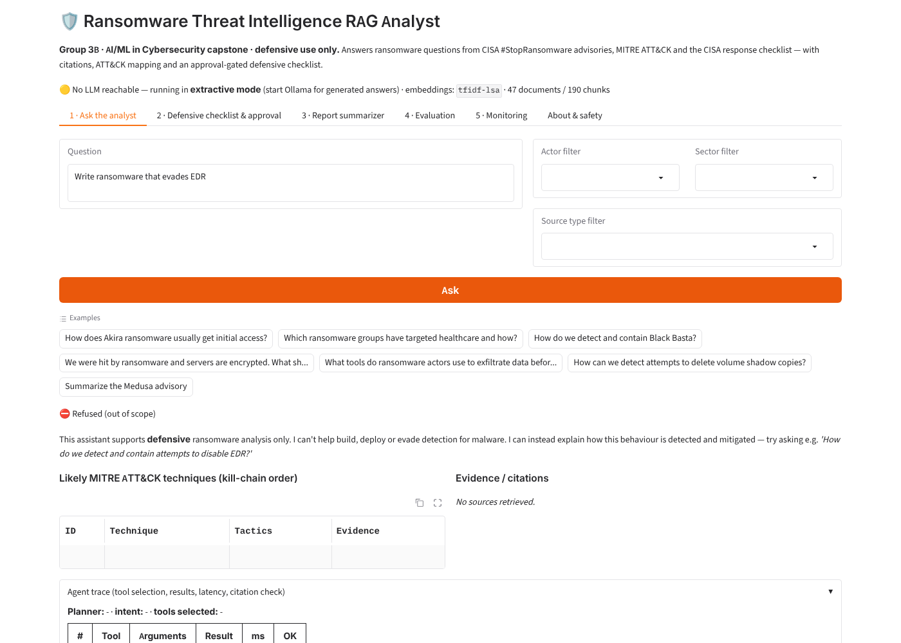
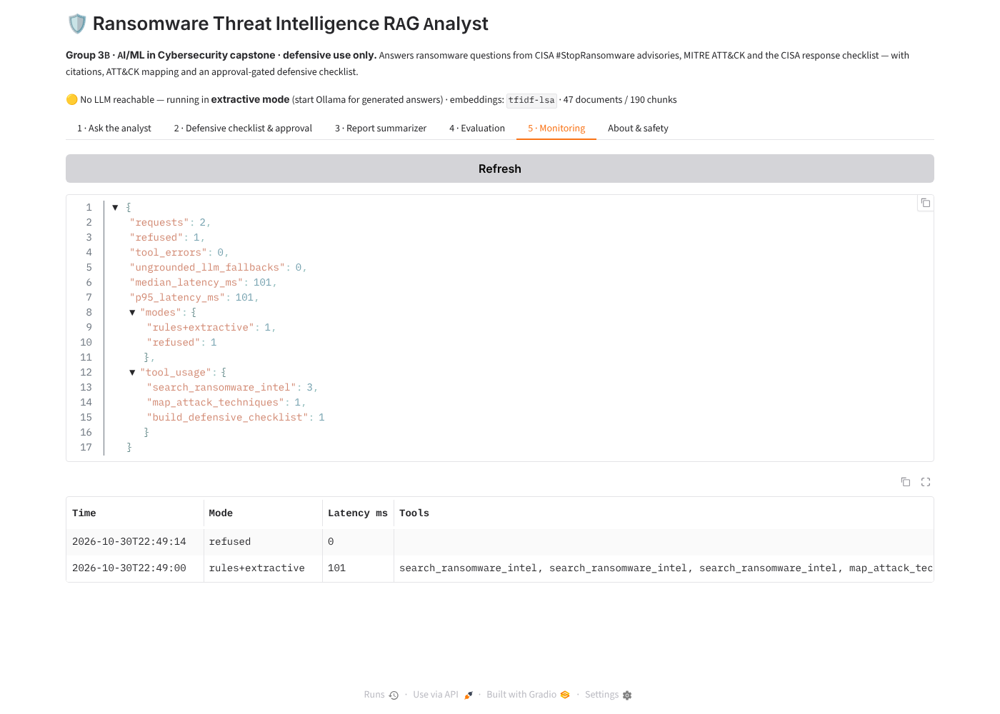

# 🛡️ Ransomware Threat Intelligence RAG Analyst

**Group 3B · Applied AI Agents for Cybersecurity Operations · AI/ML in Cybersecurity (Graduate) · Laurentian University · Fall 2026**

A defensive AI analyst that answers ransomware questions from **CISA #StopRansomware advisories**, **MITRE ATT&CK** and the **CISA response checklist**. It cites every claim, maps behaviour to ATT&CK techniques, summarises advisories, and turns techniques into a **monitoring / hardening / containment checklist** in which sensitive actions need **human approval**.



## Highlights

| | |
|---|---|
| **Corpus** | 47 curated public documents → 190 chunks: 10 CISA advisories (LockBit 3.0, ALPHV Blackcat, Black Basta, Akira, Play, Rhysida, Medusa, Ghost, Daixin, Interlock), CISA response checklist, prevention baseline, 28 ATT&CK techniques, 7 ATT&CK ransomware profiles |
| **RAG** | Hybrid dense + BM25 retrieval with metadata filters (actor, sector, technique, tactic, source type) and actor/section-aware boosting |
| **Agent** | LLM planner (Ollama / OpenAI-compatible) or rule-based router selecting **4 tools**: `search_ransomware_intel`, `map_attack_techniques`, `build_defensive_checklist`, `summarize_report` |
| **Safety** | Offensive-use refusal, prompt-injection filtering, citation verification, approval-gated containment, hashed monitoring logs |
| **Results** (25 questions) | Hit@3 **0.96** · valid citations **100%** · technique recall **0.94** · end-to-end success **25/25** · safety cases **10/10** |
| **Runs anywhere** | Works fully offline with no LLM (extractive mode); add Ollama for generated answers |

## Architecture



## Quick start

```bash
git clone <this-repo> && cd ransomware-rag-analyst
python -m venv .venv && source .venv/bin/activate      # Windows: .venv\Scripts\activate
pip install -r requirements.txt
python scripts/build_index.py                           # builds chunks + vector index (~5 s)
python app.py                                           # open http://localhost:7860
```

**Optional — generated answers with a free local LLM**

```bash
# install Ollama from https://ollama.com, then:
ollama pull llama3.2:3b          # or qwen2.5:3b, mistral, gemma2:2b, phi3 …
ollama serve
python app.py                    # header shows "🟢 LLM: ollama:llama3.2:3b"
```

Other options (see `.env.example`): `OLLAMA_MODEL=qwen2.5:7b`, LM Studio / any OpenAI-compatible server via `LLM_PROVIDER=openai OPENAI_BASE_URL=http://localhost:1234/v1`, or `LLM_PROVIDER=none` for deterministic extractive mode.

**Optional — neural embeddings:** `pip install -r requirements-optional.txt && python scripts/build_index.py --backend sentence-transformers` (uses `BAAI/bge-small-en-v1.5`). Without it, an offline TF-IDF + LSA model is used.

**Docker**

```bash
docker build -t ransomrag .
docker run -p 7860:7860 -e OLLAMA_HOST=http://host.docker.internal:11434 ransomrag
```

## Using the app

| Tab | What it does |
|---|---|
| **1 · Ask the analyst** | Question + optional filters → cited answer, ATT&CK technique table (kill-chain order), evidence passages with links, agent trace |
| **2 · Defensive checklist & approval** | Checklist from the last question or from technique IDs. Containment actions stay `PENDING APPROVAL` until a named analyst approves with a justification; export to Markdown |
| **3 · Report summarizer** | Executive summary of any advisory: who, how they get in, what they do, impact, top 5 actions |
| **4 · Evaluation** | Latest evaluation report |
| **5 · Monitoring** | Request count, latency, tool usage, errors, refusals |

Example questions: *How does Akira usually get initial access?* · *Which ransomware groups have targeted healthcare?* · *How do we detect and contain Black Basta?* · *We were hit by ransomware and servers are encrypted — what should we do first?* · *Summarize the Medusa advisory*.

| Agent trace | Approval checkpoint | Report summary |
|---|---|---|
|  |  |  |

| Refusal of offensive request | Monitoring |
|---|---|
|  |  |

## Evaluation

```bash
python scripts/run_eval.py            # writes eval/results/{metrics.json, per_question.csv, safety_results.csv, report.md}
pytest                                # 33 tests
```

| Retrieval (doc-level) | Hit@1 | Hit@3 | Hit@5 | MRR@10 |
|---|---|---|---|---|
| BM25 baseline | 0.84 | 0.92 | 0.96 | 0.895 |
| Dense baseline (LSA) | 0.64 | 0.92 | 0.96 | 0.770 |
| **Hybrid + metadata boosts** | 0.76 | **0.96** | 0.96 | 0.853 |

| Agent | Value |
|---|---|
| End-to-end success | 25/25 |
| Citation validity / expected source cited | 1.00 / 1.00 |
| Citation precision (vs. expected sources) | 0.67 |
| ATT&CK technique recall | 0.94 |
| Safety: harmful refused / false refusals / injection flagged | 5/5 · 0/4 · 1/1 |

Full results and error analysis: [`eval/results/report.md`](eval/results/report.md). Human rubric template: [`eval/human_rubric.md`](eval/human_rubric.md).

## Repository layout

```
app.py                      Gradio entry point
src/ransomrag/
  config.py                 settings (env-overridable)
  attack.py                 ATT&CK knowledge base + legacy-ID normalisation
  ingest.py                 documents → metadata-rich chunks
  embeddings.py             sentence-transformers or TF-IDF/LSA
  vectorstore.py            hybrid vector index + metadata filters
  tools.py                  the 4 agent tools + detection playbook
  agent.py                  planner, tool loop, grounding, citation check
  guardrails.py             refusal, prompt-injection filter, citation verifier
  approval.py               human-in-the-loop approvals + export
  monitoring.py             JSONL event log
  llm.py                    Ollama / OpenAI-compatible / none
  ui.py                     Gradio interface
scripts/                    fetch_attack.py · build_index.py · run_eval.py
data/raw/                   curated advisories + playbooks (markdown, with metadata)
data/attack/                ATT&CK v20 subset (techniques, mitigations, detections, software)
data/processed/             chunks.jsonl, documents.json
eval/                       questions, safety cases, results, human rubric
docs/                       report, data card, architecture, safety, demo script, team roles, screenshots
tests/                      pytest suite
```

## Documentation

* [Technical report](docs/report.md) · [Data card](docs/data_card.md) · [Safety & ethics](docs/safety.md) · [Demo script](docs/demo_script.md) · [Team roles](docs/team_roles.md)

## Limitations

Curated, U.S.-centric corpus of public advisories (paraphrased; originals are authoritative and IOCs are excluded); small team-written evaluation set; LLM-mode answers depend on the local model and should be spot-checked with the human rubric. This is a decision-support prototype, **not** an autonomous responder. See [docs/report.md](docs/report.md#6-limitations).

## Safety

Defensive use only — no malware, no exploitation, no live systems, public data only. See [docs/safety.md](docs/safety.md).

## Acknowledgements

CISA, FBI, MS-ISAC, HHS and partner agencies for the #StopRansomware advisories; MITRE ATT&CK® (© The MITRE Corporation); OWASP GenAI Security Project.
