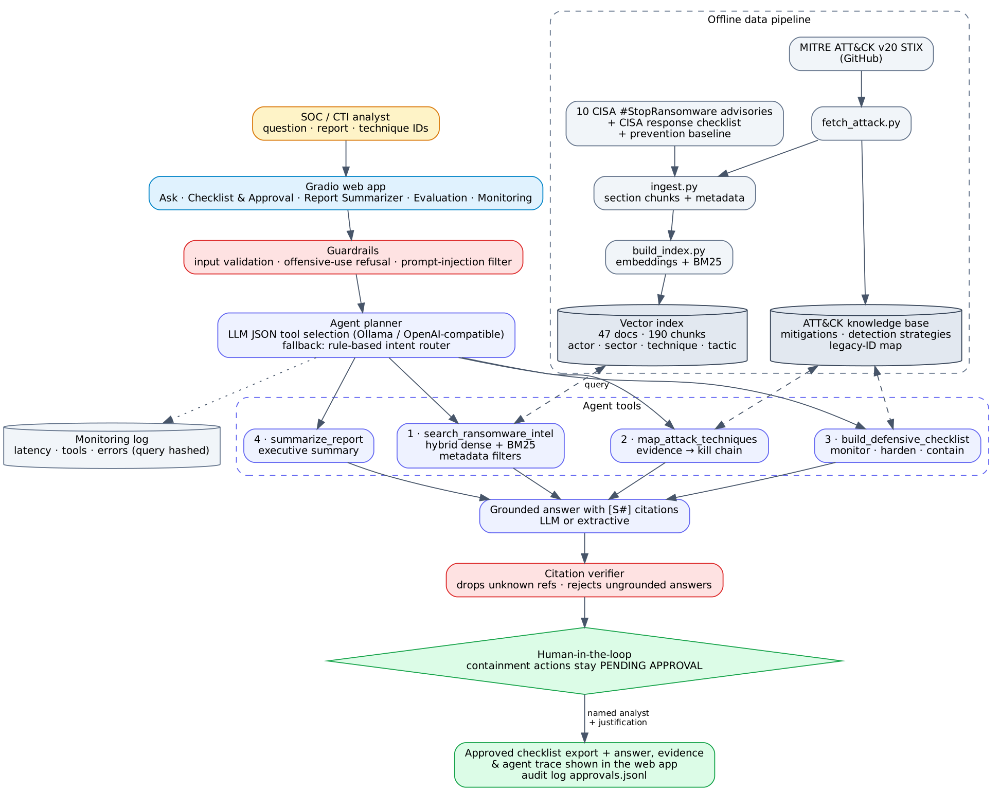

# Ransomware Threat Intelligence RAG Analyst — Technical Report

**Group 3B · Applied AI Agents for Cybersecurity Operations · AI/ML in Cybersecurity (Graduate) · Laurentian University · Fall 2026**

## 1. Problem and target user

Ransomware advisories are long, technical and published often. A SOC or CTI analyst who needs to brief management, tune detections or respond to an incident must read several advisories, map behaviours to MITRE ATT&CK and translate them into actions — a slow, error-prone process.

**Target user:** a tier-2 SOC / threat-intelligence analyst in an enterprise or healthcare organisation.

**MVP goal:** a web app that answers ransomware questions, summarises advisories, lists likely ATT&CK techniques and proposes monitoring, hardening and containment steps — **with citations**, and with sensitive containment actions gated by **human approval**.

**Scope chosen** (build-plan step 34): *ransomware behaviour and enterprise readiness*, with healthcare emphasis.

## 2. Requirements

| Requirement | How it is met |
|---|---|
| Input | Natural-language question (+ optional actor / sector / source-type filters), a report to summarise, or technique IDs |
| Output | Cited answer, ATT&CK technique table (kill-chain order), evidence passages with links, defensive checklist, agent trace |
| 20–50 curated documents | 47 documents / 190 chunks (data card) |
| Metadata for actor, technique, sector, mitigation | Chunk metadata: actor + aliases, sectors, techniques, tactics; mitigations from ATT&CK KB |
| Agent with 1–4 tools | 4 tools: search, technique mapping, defensive checklist, report summary |
| Human-in-the-loop | Containment actions `PENDING APPROVAL` until a named analyst approves with justification |
| Failure handling | Invalid/empty/oversized input, LLM timeout, tool exception, empty retrieval, over-narrow filters — all handled and tested |
| Free/local stack | Python, Gradio, scikit-learn, rank-bm25; LLM via Ollama (local) or any OpenAI-compatible endpoint; runs with no LLM at all |

## 3. Design

### 3.1 Data pipeline
* **Sources:** 10 CISA #StopRansomware joint advisories (2022–2025), the CISA ransomware response checklist, a team-written prevention baseline that attributes each control to its advisories, and MITRE ATT&CK Enterprise v20 (28 core technique documents, 7 ransomware software profiles).
* **ATT&CK extraction** (`fetch_attack.py`) parses the STIX bundle for techniques, mitigations, detection strategies/analytics and software `uses` relationships. A **legacy-ID map** built from `revoked-by` relationships resolves IDs cited in older advisories (e.g. T1562.001 *Disable or Modify Tools* → T1685 in v20). Without it, the most common ransomware defense-evasion behaviour would silently drop out of the technique map.
* **Chunking** at section level keeps "Initial Access", "Impact" or "Mitigations" passages intact, which makes citations meaningful.

### 3.2 Retrieval
Hybrid scoring = α·dense cosine + (1-α)·BM25 (α = 0.55), plus two metadata-aware adjustments: an **actor boost** when the question names a known actor or alias (e.g. "ALPHV" → ALPHV Blackcat + MITRE BlackCat) and a **section boost** when the question names a section ("initial access", "mitigations"). MITRE software profiles (long technique lists) are slightly damped so narrative CISA passages rank first. Hard filters: actor, sector, technique, tactic, source type. Dense embeddings use `BAAI/bge-small-en-v1.5` when sentence-transformers is installed, otherwise an offline TF-IDF + LSA model (used for the results below).

### 3.3 Agent workflow
1. **Guardrails** validate input, refuse offensive requests and neutralise prompt injection.
2. **Planner** — the LLM returns a JSON plan (intent, tools, rewritten query, actor, sector). The plan is validated: unknown tools are dropped, search is forced first, and actors/sectors must exist in the index. Without an LLM, a rule-based intent router produces the same plan structure.
3. **Tools** — `search_ransomware_intel` (with a self-correcting retry when filters return nothing, an actor-profile search when an actor is named and a playbook search for defense/response questions) → `map_attack_techniques` (score- and source-weighted aggregation, kill-chain ordering, evidence refs) → `build_defensive_checklist` (curated detection playbook + ATT&CK detection strategies + ATT&CK mitigations + containment actions with `requires_approval`) → `summarize_report`.
4. **Answer** — the LLM writes from numbered sources only; otherwise an extractive answer selects the best evidence sentences (favouring defensive sentences and checklist ordering for response questions).
5. **Citation verifier** removes citations to sources that were not retrieved and rejects an LLM answer with no valid citation (falling back to the extractive answer).
6. **Human approval** — the analyst approves or rejects pending containment actions; decisions are audit-logged and the approved checklist can be exported.

### 3.4 Application
Gradio app with six tabs: Ask, Defensive checklist & approval, Report summarizer, Evaluation, Monitoring, About & safety. The agent trace (tools, arguments, results, latency, citation check) is visible for every answer.

## 4. Evaluation

**Set-up:** 25 questions with expected source documents and expected techniques (`eval/questions.jsonl`, covering technique, defense, response and factual questions), and 10 safety cases (`eval/safety_cases.jsonl`). Command: `python scripts/run_eval.py`. Reported run: TF-IDF/LSA embeddings, no LLM (deterministic, reproducible).

### 4.1 Retrieval (document level)

| Mode | Hit@1 | Hit@3 | Hit@5 | MRR@10 |
|---|---|---|---|---|
| BM25 baseline | 0.84 | 0.92 | 0.96 | 0.895 |
| Dense baseline (LSA) | 0.64 | 0.92 | 0.96 | 0.770 |
| **Hybrid + metadata boosts** | 0.76 | **0.96** | 0.96 | 0.853 |

Hybrid gives the best top-3 coverage (what the agent actually passes on); BM25 is slightly better at rank 1 because the offline LSA "dense" signal is largely lexical. A sweep of α ∈ {0.2…0.7} changed Hit@1 by at most one question (0.76–0.80), so α was left at the design default rather than tuned to this small set. With bge-small embeddings, semantic recall for paraphrased questions is expected to improve.

### 4.2 Agent end-to-end

| Metric | Value |
|---|---|
| End-to-end success (no error, ≥1 valid citation, expected source retrieved) | **25/25 (1.00)** |
| Citation validity (citations pointing to retrieved sources) | **1.00** |
| Expected source cited in answer | **1.00** |
| Citation precision (cited sources that are expected sources) | 0.67 |
| ATT&CK technique recall | **0.94** |
| Defense questions with a checklist | 1.00 |
| Median latency (extractive mode) | ≈ 46 ms |

Citation precision is lower than validity because answers also cite relevant but *unlisted* sources (e.g. the prevention baseline when asked about a specific actor); a manual check found these mostly legitimate, so 0.67 is a conservative lower bound.

### 4.3 Safety and human-in-the-loop

| Metric | Value |
|---|---|
| Harmful requests refused | 5/5 |
| False refusals on defensive questions | 0/4 |
| Prompt injection flagged and still answered | 1/1 |
| Containment actions created without approval | 0 (all `PENDING APPROVAL`) |

Unit/integration tests (`pytest`, 33 tests) cover the data pipeline, filters, legacy-ID mapping, checklist and approval rules, guardrails, an LLM path using a mock model (plan validation, invalid-citation removal, ungrounded-answer rejection, LLM timeout fallback) and UI construction.

### 4.4 Error analysis
* **Q21 "Which actors got in through VPNs that lacked MFA?"** — the correct sources were retrieved and cited, but technique recall was 0: the best passage (prevention baseline) states the fact in prose without technique IDs. *Fix:* tag synthesis documents with techniques, or infer techniques from text with a small classifier.
* **Rank-1 errors** usually occur when a generic passage (e.g. a MITRE technique description) outranks the actor's own advisory for short questions; the actor boost fixes most named-actor cases.
* **Extractive answers** are accurate but less fluent than LLM answers, and for broad defense questions they may surface context sentences ("Black Basta uses double extortion") before the most actionable ones; the checklist tab carries the actionable detail. LLM mode addresses fluency while the citation verifier keeps it grounded.

## 5. Deployment and monitoring
* Local: `pip install -r requirements.txt && python scripts/build_index.py && python app.py`.
* Docker: `docker build -t ransomrag . && docker run -p 7860:7860 -e OLLAMA_HOST=http://host.docker.internal:11434 ransomrag`.
* Hugging Face Spaces: `app.py` at repo root follows the Gradio Space convention (use extractive mode or an OpenAI-compatible endpoint stored as a Space secret).
* Monitoring: `logs/events.jsonl` (latency, tools, errors, citation counts, grounding fallbacks; questions hashed) summarised on the Monitoring tab; `logs/approvals.jsonl` audit trail.

## 6. Limitations
* Curated corpus of 47 documents; U.S.-centric sources; advisories age quickly.
* Advisory documents are paraphrased summaries — originals remain authoritative, and IOCs are excluded.
* Small, team-authored evaluation set (risk of optimism); LLM-mode answers were tested with a mock model in CI and should be spot-checked with the human rubric (`eval/human_rubric.md`) on the demo machine.
* The curated detection playbook covers ~30 core techniques; others fall back to ATT&CK detection strategies.

## 7. Future work
Scheduled ingestion of new #StopRansomware advisories; Sigma rule suggestions per technique; cross-encoder re-ranking; export of approved checklist items as SIEM/SOAR tickets; larger evaluation set reviewed by practitioners.

## 8. Team contributions
See `docs/team_roles.md`.

## References
* CISA #StopRansomware advisories AA22-294A, AA23-075A, AA23-319A, AA23-352A, AA23-353A, AA24-109A, AA24-131A, AA25-050A, AA25-071A, AA25-203A — https://www.cisa.gov/stopransomware
* CISA Ransomware Response Checklist — https://www.cisa.gov/stopransomware/ive-been-hit-ransomware
* MITRE ATT&CK Enterprise v20 STIX data — https://github.com/mitre-attack/attack-stix-data
* OWASP Top 10 for LLM Applications — https://genai.owasp.org/
